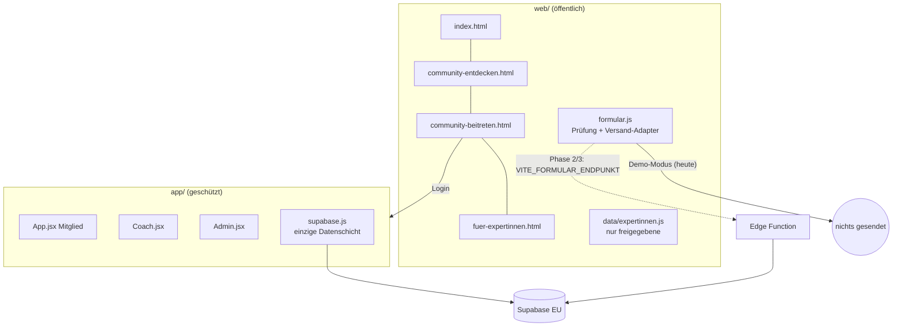

# Architektur

Gesamtbild und Phasen: [`UMSETZUNGSPLAN.md`](UMSETZUNGSPLAN.md) · Entscheidungen: [`DECISIONS.md`](DECISIONS.md)

## Repository-Struktur (eine Hauptversion)

| Pfad | Inhalt | Status |
|---|---|---|
| `app/` | Mitglieder-PWA + `#coach` + `#admin` (React 18, Vite) | live, unverändert in diesem Inkrement |
| `web/` | Öffentliche Website Phase 1 (statisch, Vite-Mehrseiten) | **neu**, lokal getestet, nicht deployt |
| `backend/supabase/` | Migrationen, Edge Functions | bestehend, unverändert |
| `doku/plattform/` | Plattform-Dokumentation (dieser Ordner) | neu |

## Komponenten

## Rollenmatrix (Ziel, Masterplan 03)

| Bereich / Aktion | Gast | Mitglied | Expertin (geprüft) | Moderatorin | Admin |
|---|---|---|---|---|---|
| Öffentliche Seiten, Bewerbung | ✓ | ✓ | ✓ | ✓ | ✓ |
| Eigenes Profil, eigene Daten, Export/Löschung | – | ✓ | ✓ | ✓ | ✓ |
| Community lesen/posten, melden, blockieren | – | ✓ | ✓ | ✓ | ✓ |
| Gekaufte Kurse / gebuchte Events | – | eigene | eigene | eigene | Support-Sicht |
| Privates Journal | – | nur selbst | nur selbst | ✗ | ✗ (kein pauschaler Zugriff) |
| Eigene Produkte/Kurse/Events/Challenges anlegen | – | – | ✓ (erst nach `seller_ready`) | – | – |
| Teilnehmer-/Umsatzdaten | – | – | nur eigene, nur erlaubte Felder | ✗ | ✓ (Audit) |
| Moderationsfälle | – | – | – | zugewiesene | ✓ |
| Expertinnen freigeben, Rollen vergeben | – | – | – | – | ✓ (MFA + Audit-Log) |

Ein Konto kann mehrere Rollen haben (`user_roles`). Prüfung serverseitig und per RLS.

**Ist-Zustand (Phase 0):** Rollen sind heute über `coaches` (Flag per Coach-Code) und `admins` abgebildet; Moderatorin und Expertin-Freigabeprozess existieren noch nicht.

## Datenflüsse Phase 1 (öffentliche Website)
- Keine Cookies, kein Tracking, keine Drittanbieter-Requests (per E2E-Test geprüft).
- Formulare: Validierung im Browser; ohne Endpunkt **keine Übertragung**.
- Einziger externer Link: „Login“ → `VITE_APP_URL` (Standard `https://smile2go-app.vercel.app`).
