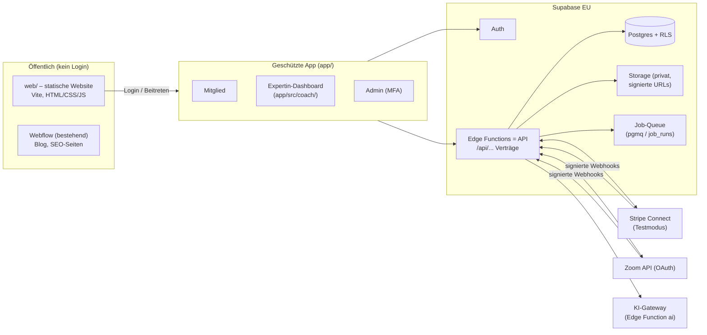

# Smile2Go · Umsetzungsplan A–Z

Stand: 17.11.2026 · Grundlage: *Smile2Go Master Development Specification v1.0* (Claude-Masterplan) und *Architektur- & QA-Kontrollplan v1.0* (unabhängige Prüfgrundlage).
Kanonisches Repository: `github.com/ilho1907/smile2go`, Hauptbranch `main` (Ausgangs-Commit `cc3c766`).

> Dieser Plan beschreibt **Anforderungen und Reihenfolge**. Was davon tatsächlich gebaut und getestet ist, steht ausschließlich in [`PROJECT_STATUS.md`](PROJECT_STATUS.md).

---

## 1. Ausgangslage (Ergebnis Phase 0)

Smile2Go ist **kein leeres Projekt**. Im Repo existiert eine live laufende Mitglieder-App:

| Baustein | Stand | Ort |
|---|---|---|
| Mitglieder-PWA (React 18 + Vite, JavaScript) | live auf `smile2go-app.vercel.app` | `app/` |
| Coach-Panel (`#coach`), Admin (`#admin`) | live, Hash-Routing | `app/src/Coach.jsx`, `Admin.jsx` |
| Supabase (Postgres, Auth, Edge Functions), Region EU (Paris-Pooler) | 24 Migrationen, 40× RLS aktiviert | `backend/supabase/` |
| Coach-Codes (Coachin-Rolle nur per Code) | Migration geschrieben, **laut AUFGABEN-claude.md noch nicht in Supabase ausgeführt** | `20261112_coach_codes.sql` |
| KI-Aufrufe serverseitig (Edge Function `ai`) | vorhanden | `functions/ai` |
| Konto löschen (DSGVO) | Edge Function vorhanden | `functions/konto-loeschen` |
| Webflow-Website (33 Seiten, Staging `smile2go-8ab70d.webflow.io`) | vorhanden, Inhalte nicht von mir geprüft | Webflow-Site `6a35c9e9…8135` |
| Stripe, Stripe Connect, Zoom, Marketplace, Ledger | **nicht vorhanden** | – |

Daraus folgt die wichtigste Architekturentscheidung: **Wir erweitern die bestehende App, statt eine zweite Hauptversion (Next.js) daneben zu bauen.** Der Masterplan schlägt Next.js + TypeScript + Tailwind vor; ein Neubau würde 11 000+ Zeilen funktionierender App duplizieren und gegen die Regel „eine gemeinsame Hauptversion“ verstoßen. Details und Alternativen: [`DECISIONS.md`](DECISIONS.md) ADR-010.

## 2. Zielarchitektur (Kurzfassung)

Grundregeln (aus Masterplan 03/06/10 und bestehendem `CLAUDE.md`):
- Berechtigungen werden **serverseitig und per RLS** geprüft, nie nur im Client.
- Freischaltungen (Kurszugang, Rollen, Punkte) hängen **nur an bestätigten Server-Ereignissen** (z. B. verifizierter Stripe-Webhook), nie an Client-Redirects.
- Keine Secrets im Browser. Alles mit `VITE_` ist öffentlich.
- Datenzugriff der App läuft weiter ausschließlich über `app/src/supabase.js`.
- Ohne Schlüssel laufen Integrationen als **gekennzeichnete Mock-Adapter** (Demo-Modus).

## 3. Phasen, Abhängigkeiten, Gates

| # | Phase | Kern-Deliverables | Hängt ab von | Gate (muss nachweisbar erfüllt sein) | QA-Gate |
|---|---|---|---|---|---|
| 0 | Audit | Inventar, Gap-Liste, ADRs, Doku-Gerüst | – | Keine Überschreibung, Hauptbranch bestätigt | G0 |
| 1 | Public | `web/`: Start, Community entdecken, Community beitreten, Für Expertinnen + Bewerbung, Rechtsseiten (Entwurf) | 0 | Links/CTAs/SEO/A11y-Smoke grün, mobil geprüft | G1 |
| 2 | Identity | eine Identität, `roles`/`user_roles`, `consents`, Onboarding-API, Mitglied-Dashboard, Website-Formular an echten Endpunkt | 1, ADR-002/003 | Auth + RLS + **negative** Berechtigungstests | G2 |
| 3 | Experts | `expert_applications`, Interview-Status, Review, Freigabe, Audit-Log; Coach-Codes nach Freigabe | 2 | Ungeprüfte Seller können nicht veröffentlichen | G3 |
| 4 | Money | Produkte, Preise, Checkout, Stripe Connect (Testmodus), Entitlements, Refunds, Reconciliation | 3, ADR-004/007, **Rechts-/Steuerprüfung** | Idempotenz, Reconciliation, Sandbox-E2E | G4 |
| 5 | Community/Learning | Feed/Gruppen (bestehende `community_*` erweitern), Kurse/Module/Lektionen, Medien privat, Fortschritt | 2 (Kauf-Kurse: 4) | Private Medien geschützt, Moderation | G5 |
| 6 | Live | Zoom OAuth, Events, Registrierung, Recording-Pipeline, Replay-Freigabe → Kurs | 4, 5, ADR-005 | Keine Publikation ohne Zustimmung + Approval | G6 |
| 7 | AI/Points | Matching (Hard-Filter + erklärbar), AI Studio mit Freigabe, Challenges, Lichtpunkte-Ledger | 3, 5, ADR-006/007 | Filter, Datenschutz, Anti-Duplikation | G7 |
| 8 | Launch | Monitoring, Backups/Restore-Test, Pen-Test, Lasttest, Rechtsprüfung, Pilot | alle | QA-Bericht + Go/No-Go durch Auftraggeberin | G8 |

**Priorität:** 1 → 2 → 3 sind der kritische Pfad (ohne Identität und Expertinnen-Freigabe kein Marketplace). Phase 5 kann teilweise parallel zu 4 laufen (kostenlose Inhalte). 6 und 7 erst danach. Nie mehrere Module gleichzeitig live schalten (Risikoregister QA 08).

## 4. Phase für Phase – was konkret gebaut wird

### Phase 2 · Identity (nächster Schritt)
- Migration `YYYYMMDD_rollen_einwilligungen.sql`: `roles`, `user_roles` (m:n, ein User mehrere Rollen), `consents` (pro Zweck, Version, Zeitstempel, Widerruf), `audit_logs` (append-only).
- Abgleich mit Bestand: `coaches.ist_coach` + `admins` → werden auf `user_roles` abgebildet (Migration mit Rückwärtsplan, keine Datenlöschung).
- Edge Functions: `POST /api/auth/onboarding`, `GET /api/me`, `PATCH /api/me/preferences`.
- Website-Formular „Platz vormerken“ → Edge Function mit Double-Opt-in statt Demo-Modus.
- Tests: pgTAP oder SQL-Testskript gegen lokale Postgres (RLS-Negativtests: fremde Zeilen lesen/schreiben muss scheitern).

### Phase 3 · Expertinnen
- `expert_applications` mit Status-Maschine `submitted → screening → interview_scheduled → approved/rejected → seller_ready → suspended`; Übergänge nur per Server-Funktion, jede Änderung in `audit_logs`.
- `interview_reviews`, `credentials` (Nachweise im **privaten** Storage), `expert_profiles` (öffentliche Felder), `expert_approvals`.
- Bewerbungsformular aus `web/fuer-expertinnen.html` an `POST /api/expert-applications`.
- Admin-Oberfläche in `Admin.jsx` (Prüfliste aus Projekt-Doc „Frauen Unterstützen Frauen“, Abschnitt 1.1).
- Coach-Code wird **nach** Freigabe ausgegeben (verbindet bestehende Coach-Code-Logik mit dem Prüfprozess).

### Phase 4 · Money (nur Stripe-Testmodus bis zur Freigabe)
- `products`, `prices`, `orders`, `order_items`, `payments`, `payment_events`, `refunds`, `entitlements`, `commission_rules` (versioniert), `payouts`, `seller_accounts`.
- Order-State-Machine `created → awaiting_payment → paid → fulfilled`, sonst `failed/canceled/refunded/partially_refunded`; **nur** verifizierter Webhook setzt `paid`.
- Idempotenz: `webhook_events(provider, event_id) UNIQUE`; Entitlement und Provision in **einer** Transaktion.
- Reconciliation-Job (Stripe ↔ lokales Ledger), Alarm bei Abweichung.
- Voraussetzung: Entscheidung Merchant of Record / Steuer / FernUSG (BACKLOG Punkt 5, RECHT-FernUSG-Datei).

### Phase 5 · Community & Learning
- Bestehende Tabellen `community_posts`, `community_meldungen`, `gemeinschaft*`, `kurs_module`, `kurs_fortschritt` werden geprüft und erweitert, nicht ersetzt.
- `courses`, `modules`, `lessons`, `media_assets`, `enrollments`; Medien nur über signierte, kurzlebige URLs nach Entitlement-Prüfung.

### Phase 6 · Live → Replay → Kurs
- `zoom_connections` (Token verschlüsselt, minimale Scopes), `events`, `registrations`, `recordings`, `replay_approvals`.
- Webhook `recording.completed` → dauerhafte Queue → privater Storage → Prüfung → KI-**Entwurf** (Transkript/Kapitel) → Freigabe durch Expertin → Publish erzeugt Lektion/Produkt/Entitlement.
- Vorher prüfen: Zoom-Lizenz (Cloud Recording), Kosten, EU-Datenfluss.

### Phase 7 · AI Matching & Lichtpunkte
- Matching: freiwillige `matching_preferences` → Hard-Filter (freigegeben, Sprache, Format, Preis, Verfügbarkeit) → Textvergleich → 2–5 erklärte Vorschläge. Startgewichtung 40/20/15/15/10 als **Hypothese**. Tagebuch, DMs, Gesundheitsdaten sind ausgeschlossen.
- Lichtpunkte: `points_ledger` append-only, `UNIQUE(user_id, task_completion_id, reward_type)`, Gegenbuchung statt Änderung, Tages-/Challenge-Limits. Die App vergibt heute Punkte clientseitig im `app_state`-JSON – das wird in Phase 7 auf das Ledger umgestellt (Migration der Altstände als einmalige Startbuchung).

### Phase 8 · Launch
- Monitoring/Alerts, Backup-Restore-Test, Pen-Test, Lasttest, juristische Prüfung (DSGVO, TDDDG, BFSG, DSA, DAC7/PStTG, Widerruf, Kündigungsbutton), Pilotkohorte, Go/No-Go durch ilho.

## 5. Integrationen – Stand und Regel

| Integration | Stand | Regel bis zur Freigabe |
|---|---|---|
| Supabase | vorhanden (EU) | Neue Tabellen nur per Migration + RLS |
| Stripe / Connect | fehlt | Nur Testmodus, keine echten Zahlungen |
| Zoom | fehlt | Mock-Adapter; Lizenz/Kosten vorab klären |
| KI (Anthropic über Edge Function) | vorhanden | Provider-Abstraktion, Tageslimit existiert (`ki_tageslimit`) |
| E-Mail-Versand | unklar | Anbieter + AVV entscheiden (ADR-008) |
| n8n | Workflows im Repo | nur für unkritische Hilfsabläufe |
| Webflow | vorhanden | keine Änderung/Veröffentlichung ohne ilhos Freigabe |

## 6. Offene Geschäftsentscheidungen (nicht erfunden, Masterplan 15)
Tarife und Preise · kostenlose Einstiegsrechte · Expertinnen-Provision · Refund-/Storno-Regeln · Merchant of Record und Steuermodell · Hosting/Domain der öffentlichen Website · Zoom-Lizenz · E-Mail-Anbieter · Video-Storage · Belohnungsbudget und Punkte-Wert · Moderationskapazität · Verhältnis Webflow ↔ `web/` (ADR-001) · Einbindung des geplanten Zoom-Kennenlerngesprächs vor der Registrierung.
